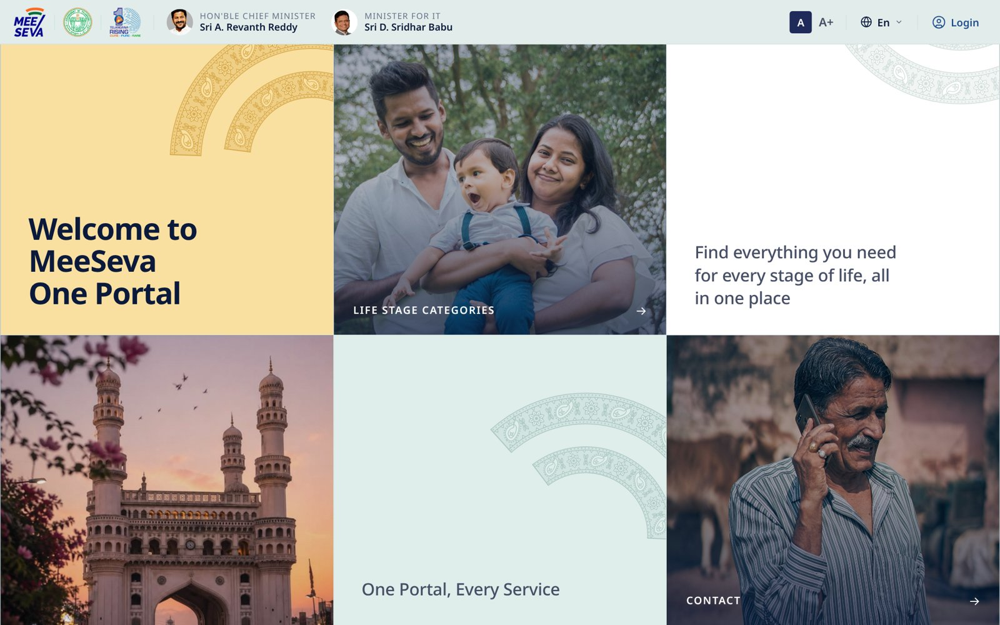
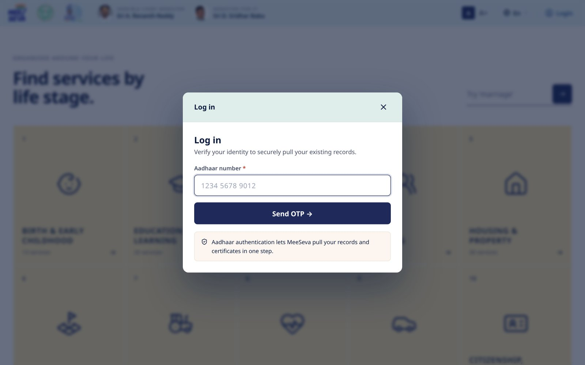
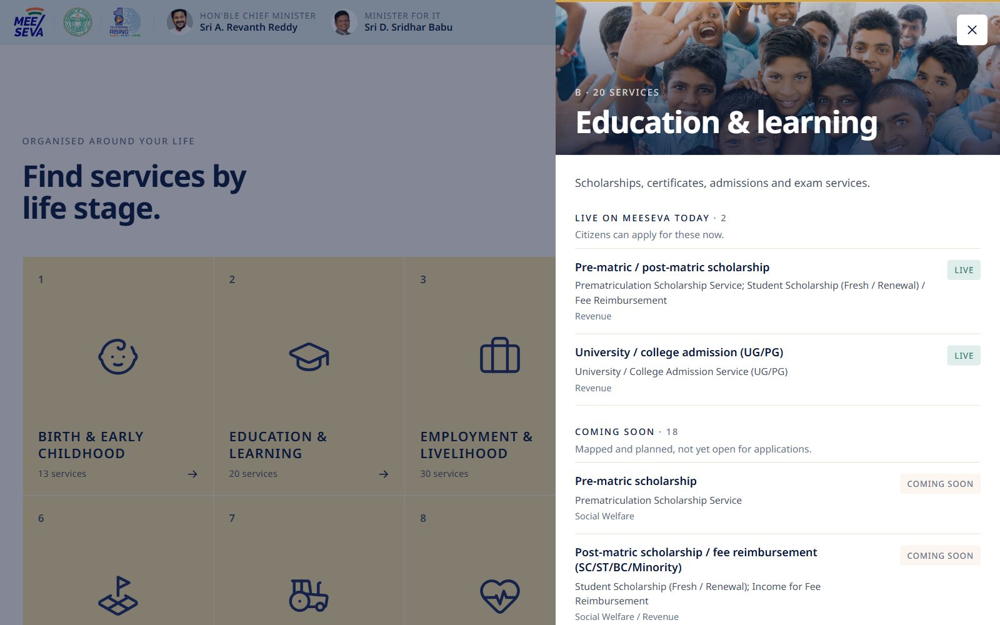
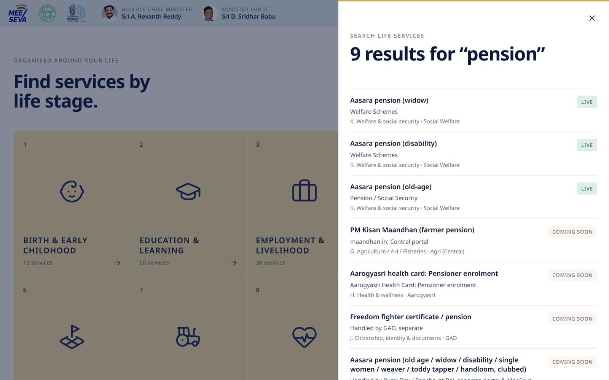
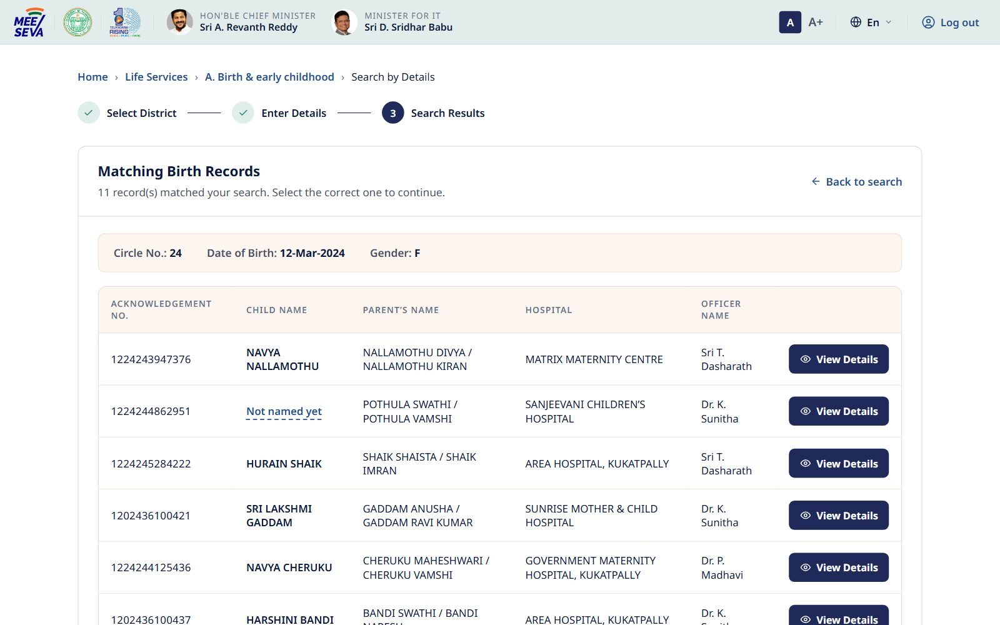
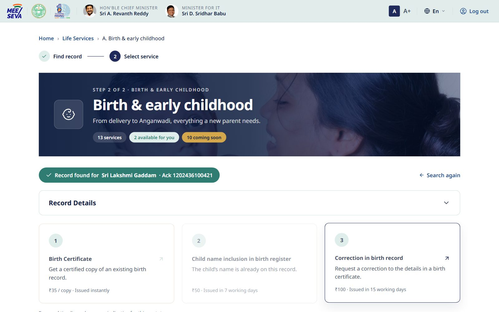
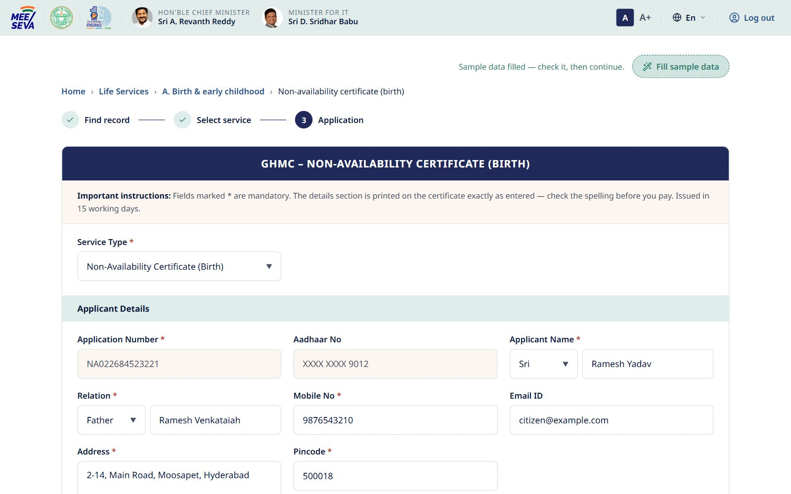
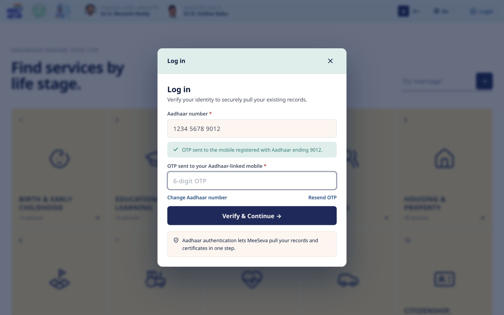
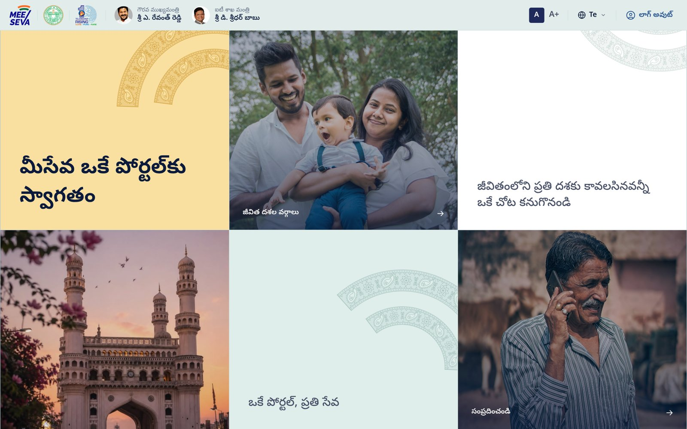
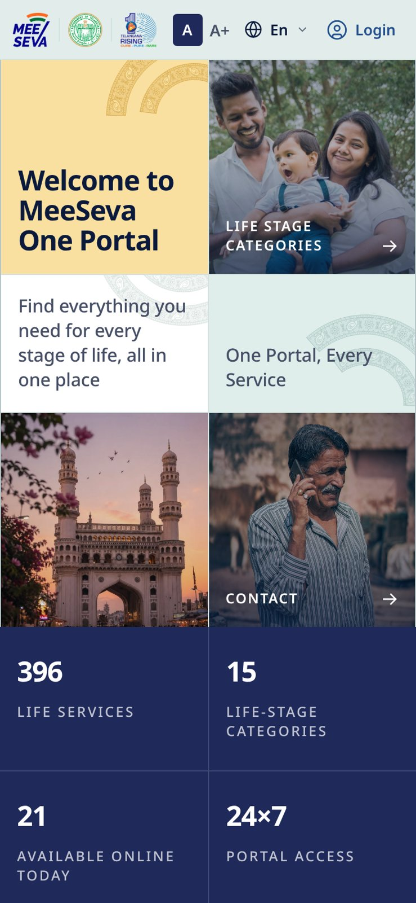

# MeeSeva One Portal

The single-window citizen services portal for the Government of Telangana, organised around the moments of a citizen's life.

**Live application:** https://meeseva-v7-happening.vercel.app



## Project overview

Telangana offers hundreds of government services through MeeSeva. Citizens usually don't know which department owns a service. They do know what's happening in their life: a child was born, they bought land, a parent passed away.

This portal groups 396 life services into 15 life stage categories. A citizen picks the stage they're in, logs in with Aadhaar and OTP, and sees every service that applies. Services already online are tagged **Available**. The rest are mapped and tagged **Coming soon**.

Built by [Happening Design](https://www.happening.design/).

## Features

- **Life stage navigation.** 15 categories, from Birth & early childhood to End of life & legacy.
- **Service catalogue.** 327 services mapped with event, service name and department. 21 are live today.
- **Aadhaar + OTP login.** A two step dialog that gates access to the service lists. After login the citizen lands on the stage they clicked.
- **Birth & early childhood services, end to end.** This life stage opens as its own set of pages:
  - **Find the birth record.** Search by details (district, then the GHMC or municipal registration details) or by acknowledgement number. The matching records appear in a table.
  - **Choose a service.** Birth certificate, child name inclusion, correction in a birth record, or a Non-Availability Certificate when no record exists.
  - **Apply.** A GHMC style application form with validation, then payment, an acknowledgement with an application number, and a printable certificate.
  - **Track.** Applications are listed on the life stage page, where they can be viewed or withdrawn.
- **Fill sample data.** One button at the top of each form fills it with realistic sample values, for demos.
- **Search.** Matches service names, life events and departments in English and Telugu. Live services rank first.
- **Bilingual interface.** English and Telugu, with the choice saved per browser. Urdu is listed as coming soon.
- **Accessibility.** A / A+ text size, a skip link, focus trapping in dialogs, Escape to close, and reduced motion support.
- **Responsive.** One layout from 360px phones to wide desktops, with no horizontal scroll.
- **Kalamkari decoration.** The MeeSeva logo's arcs, redrawn with Kalamkari motifs, decorate the hero panels.

## Technology stack

| Layer | Choice |
| --- | --- |
| Markup | HTML5 |
| Styling | CSS3 with custom properties (design tokens) |
| Behaviour | Vanilla JavaScript (ES2020), no framework |
| Typography | Noto Sans and Noto Sans Telugu, self hosted (SIL Open Font License) |
| Hosting | Vercel, as a static site |
| Testing | Playwright (Python) on Chromium |

There is no build step. The files in this repository are exactly what the browser loads.

## Project structure

```
meeseva-one-portal/
├── index.html              # page markup: header, hero, life stage grid, service pages, drawer, login dialog, footer
├── css/
│   ├── fonts.css           # @font-face rules for the self hosted Noto fonts
│   └── main.css            # design tokens, layout, components, motion
├── js/
│   ├── catalogue.js        # 15 life stages, 327 services, English and Telugu strings
│   ├── photos.js           # life stage photo paths
│   └── app.js              # rendering, drawer, search, login, language, text size,
│                           # and the Birth & early childhood service pages
├── assets/
│   ├── fonts/              # Noto Sans, Noto Sans Telugu (woff2)
│   ├── img/                # logos, leader photos, hero tiles, favicon
│   └── photos/             # one photo per life stage (Unsplash, Pexels, Wikimedia)
├── tests/
│   ├── e2e/test_portal.py  # 44 end to end test cases
│   ├── requirements.txt
│   └── results/results.json
└── docs/
    ├── TESTING.md          # test cases, results, bugs, retesting
    └── screenshots/
```

## Installation

You need a modern browser. To run the tests you also need Python 3.9+.

```bash
git clone https://github.com/bedantabaruah/meeseva-one-portal.git
cd meeseva-one-portal
```

## How to run the application

Serve the folder with any static file server:

```bash
python3 -m http.server 8000
```

Then open http://localhost:8000.

Or use the hosted version at https://meeseva-v7-happening.vercel.app.

## Configuration

This build needs no environment variables, API keys or credentials. Nothing secret lives in this repository.

Login runs in **prototype mode**. Any 12 digit Aadhaar number and any 6 digit OTP will sign in. Nothing is sent anywhere. The session lasts until the browser tab is closed.

The Birth & early childhood pages also run in prototype mode:
- **Sample register.** Every search returns sample birth records for the details entered, and the same search always gives the same list.
- **Simulated payment.** No money is taken.
- **Documents stay on the device.** Uploaded files never leave the browser.
- **Applications stay in the browser.** They're saved only in this browser.
- **Sample certificates.** Certificates are marked as samples, not legal documents.

## Usage

1. Open the portal. The home page shows the welcome panel and four headline numbers.
2. Scroll to **Find services by life stage** and pick a stage, for example *Birth & early childhood*.
3. Log in. Enter a 12 digit Aadhaar number, choose **Send OTP**, enter a 6 digit OTP, then choose **Verify & Continue**.
4. *Birth & early childhood* opens its own pages:
   1. Choose **Search by Details**, then pick a district and choose **Next**.
   2. Enter the birth details and choose **Search Birth Record**. To skip typing, choose **Fill sample data** at the top of any form.
   3. Choose **View Details** on the right record, then pick a service.
   4. Complete the application form, choose **Show Payment**, then **Pay & Submit**. You get an application number, and for a birth certificate, the certificate.
   5. If no record exists, the **Non-Availability Certificate** route takes the citizen through the same steps.
5. Every other stage opens in a side drawer. Services are split into **Live on MeeSeva today** and **Coming soon**.
6. Use the search box to find a service by name, for example *pension* or *birth certificate*.
7. Switch to Telugu from the **En** menu in the header. Use **A+** for larger text.
8. Choose **Log out** in the header to end the session.

| Login | Service list | Search |
| --- | --- | --- |
|  |  |  |

| Birth records found | Choose a service | Application |
| --- | --- | --- |
|  |  |  |

| OTP step | Telugu | Mobile |
| --- | --- | --- |
|  |  |  |

## Testing

```bash
pip install -r tests/requirements.txt
python -m playwright install chromium

python3 -m http.server 8000 &          # serve the app
python3 tests/e2e/test_portal.py       # run against http://localhost:8000
python3 tests/e2e/test_portal.py https://meeseva-v7-happening.vercel.app/   # or against the live site
```

The suite covers 44 cases across home, login, services, search, language, accessibility, stability, mobile layout and the Birth & early childhood service pages. **All 44 pass.** Full results, the bug log and retesting notes are in [docs/TESTING.md](docs/TESTING.md).

## Image credits

- Life stage photos from [Unsplash](https://unsplash.com) and [Pexels](https://pexels.com) under their licences.
- *TGSRTC Electric Metro Express Bus* by TG09Z, CC BY-SA 4.0, [Wikimedia Commons](https://commons.wikimedia.org/wiki/File:TGSRTC_Electric_Metro_Express_Bus_3.jpg).
- *Fingerprint Scan, Biometric Data Collection, Aadhaar* by Biswarup Ganguly, CC BY 3.0, [Wikimedia Commons](https://commons.wikimedia.org/wiki/File:Fingerprint_Scan_-_Biometric_Data_Collection_-_Aadhaar_-_Kolkata_2015-03-18_3660.JPG).
- *High Court of Telangana in Hyderabad* by iMahesh, CC BY-SA 4.0, [Wikimedia Commons](https://commons.wikimedia.org/wiki/File:High_Court_of_Telangana_in_Hyderabad.jpg).
- Noto Sans and Noto Sans Telugu, SIL Open Font License.
