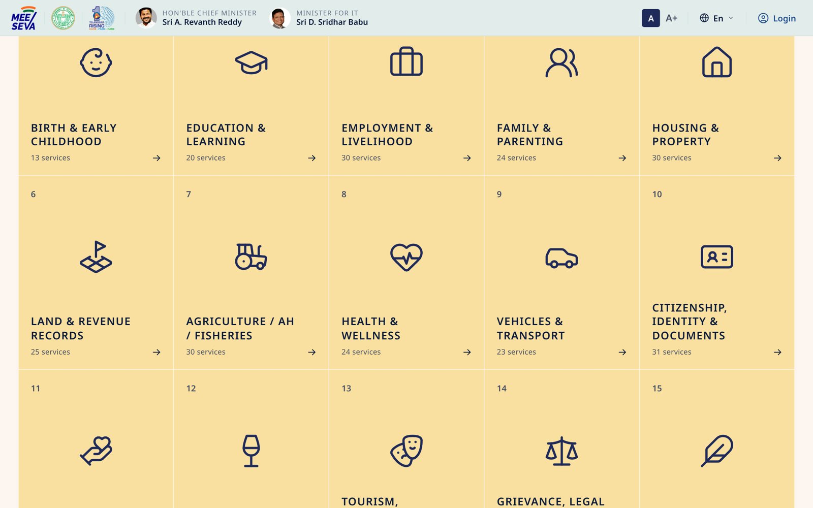
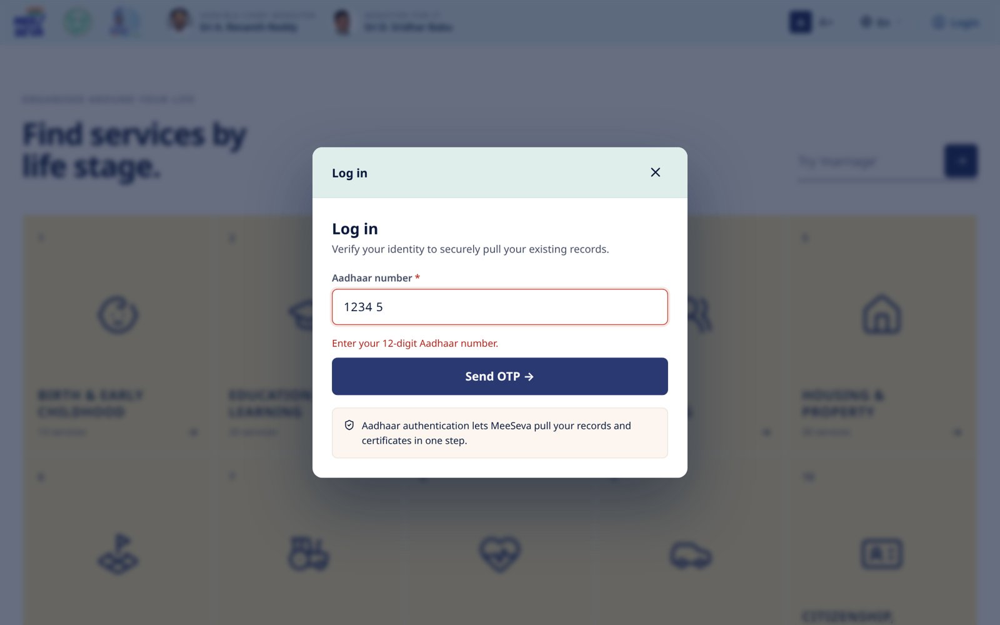
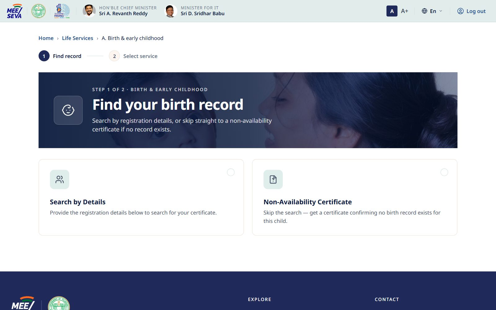
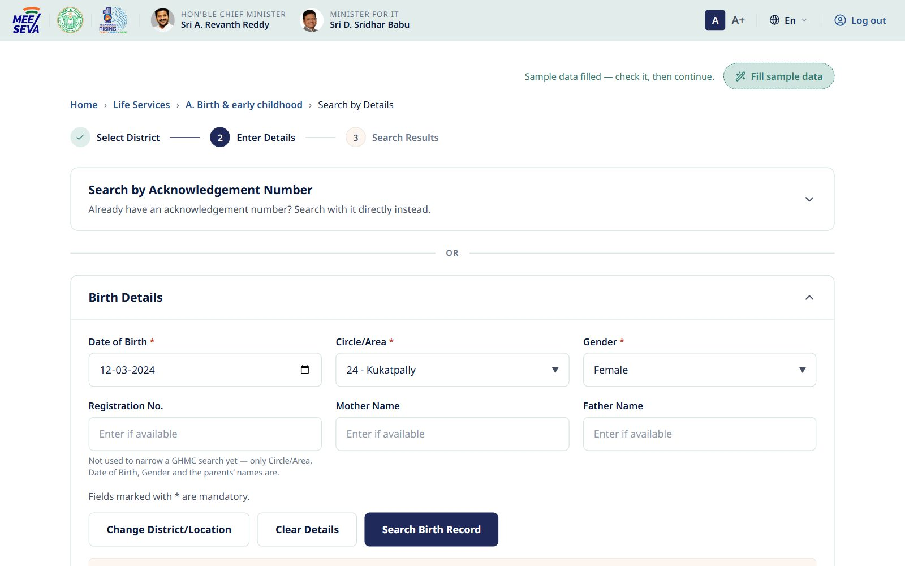
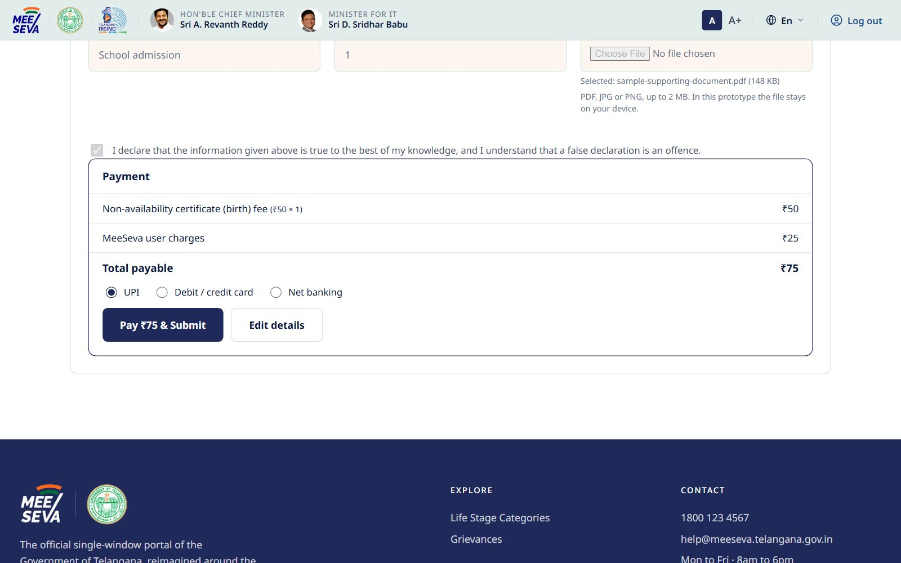
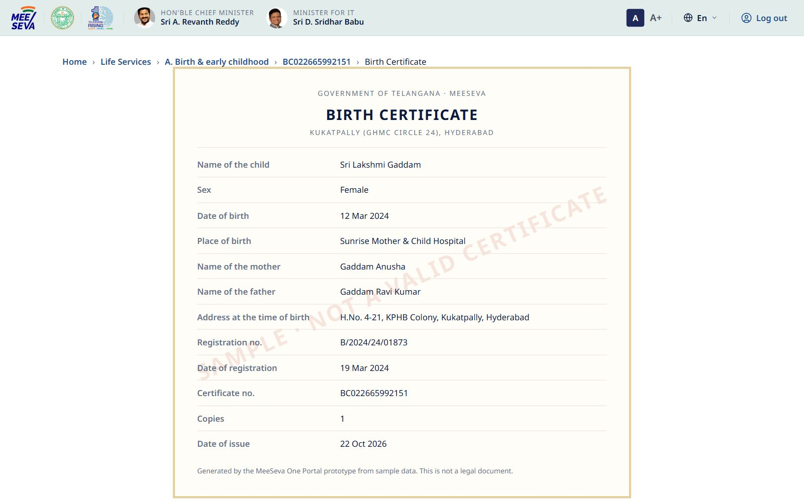
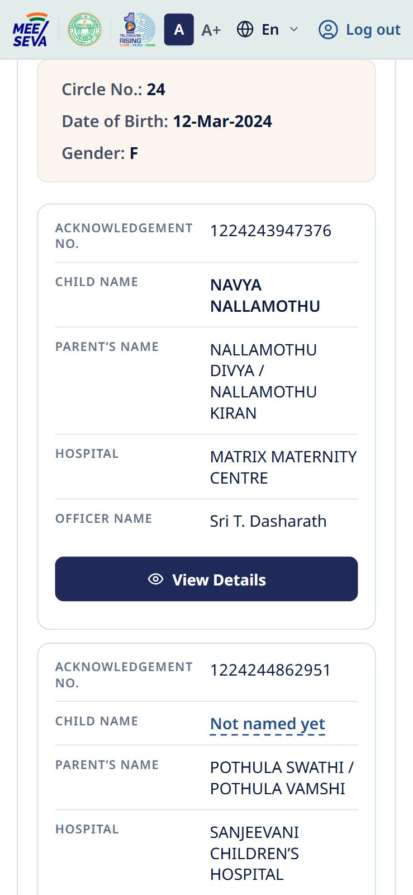

# Testing Evidence

End to end tests run in a real browser against the portal. Each case drives the interface the way a citizen would and checks the result on screen.

## Summary

| Test cases | Passed | Failed | Viewports |
| --- | --- | --- | --- |
| 44 | 44 | 0 | Desktop 1440 × 900, Mobile 390 × 844 |

| | |
| --- | --- |
| **Tool** | Playwright (Python), Chromium headless |
| **Build under test** | v7, as deployed at https://meeseva-v7-happening.vercel.app |
| **Run date** | 22 Oct 2026 |
| **Script** | [`tests/e2e/test_portal.py`](../tests/e2e/test_portal.py) |
| **Raw results** | [`tests/results/results.json`](../tests/results/results.json) |

TC01 to TC23 cover the home page, login, the service drawer, search, language, accessibility and mobile layout. TC24 to TC44 cover the Birth & early childhood service pages: finding the birth record, choosing a service, applying, paying and the acknowledgement.

## Test cases and results

| ID | Module | Test case | Expected result | Actual result | Status |
| --- | --- | --- | --- | --- | --- |
| TC01 | Home | Portal loads with correct title | Page title shows MeeSeva Life Services Portal | MeeSeva: Life Services Portal / Government of Telangana | ✅ Pass |
| TC02 | Home | Life stage grid renders | 15 life stage tiles shown | 15 tiles rendered in grid | ✅ Pass |
| TC03 | Home | Hero KPIs show catalogue counts | 396 services, 15 stages, 21 online | 396 / 15 / 21 / 24×7 | ✅ Pass |
| TC04 | Auth | Opening a life stage when logged out asks for login | Login dialog opens | Login dialog opened | ✅ Pass |
| TC05 | Auth | Submit with invalid Aadhaar (5 digits) | Validation error, OTP not sent | Error shown: "Enter your 12-digit Aadhaar number." | ✅ Pass |
| TC06 | Auth | Aadhaar input auto formats | Number grouped as 1234 5678 9012 | Field shows "1234 5678 9012" | ✅ Pass |
| TC07 | Auth | Letters typed in Aadhaar field | Non digits stripped | Field shows "1234" | ✅ Pass |
| TC08 | Auth | Send OTP with valid 12 digit Aadhaar | OTP step shown, Aadhaar field locked | OTP step visible, Aadhaar locked | ✅ Pass |
| TC09 | Auth | Verify with short OTP (3 digits) | Validation error, not logged in | Error shown: "Enter the 6-digit OTP." | ✅ Pass |
| TC10 | Auth | Verify with valid 6 digit OTP | Login successful, user continues to chosen stage | Logged in, "Find your birth record" page opened, header shows "Log out" | ✅ Pass |
| TC11 | Services | Stage drawer lists all services in the stage | Education & learning shows 20 services | "Education & learning" lists 20 services | ✅ Pass |
| TC12 | Services | Services tagged by availability | 2 Available, 18 Coming soon | 2 Available, 18 Coming soon | ✅ Pass |
| TC13 | Accessibility | Escape key closes drawer | Drawer closes, focus returns | Drawer closed | ✅ Pass |
| TC14 | Search | Search a valid keyword | Matching services listed | 9 results for "pension" | ✅ Pass |
| TC15 | Search | Search a keyword with no match | Friendly empty state, no crash | Empty state shown | ✅ Pass |
| TC16 | Language | Switch language to Telugu | Interface switches to Telugu | html lang="te", labels in Telugu | ✅ Pass |
| TC17 | Language | Language choice persists after reload | Telugu still selected | After reload: lang "te", session kept | ✅ Pass |
| TC18 | Accessibility | A+ increases text size | Large text mode applied | text size = large | ✅ Pass |
| TC19 | Auth | Session survives page reload | Logged in user goes straight to stage | Stage opened without new login | ✅ Pass |
| TC20 | Auth | Logout | Session cleared, stages require login | Header shows "Login", stages locked again | ✅ Pass |
| TC21 | Accessibility | Escape key closes login dialog | Dialog closes | Login dialog closed by Escape | ✅ Pass |
| TC22 | Stability | No JavaScript errors during session | Zero console errors | 0 errors | ✅ Pass |
| TC23 | Responsive | Mobile layout at 390px | No horizontal scroll | page width 390px at 390px viewport | ✅ Pass |
| TC24 | Birth services | Life stage opens as its own page after login | Step 1 of 2 page with Search by Details and Non-Availability Certificate | "Find your birth record" page, 2 ways to find the record, home hidden: True | ✅ Pass |
| TC25 | Birth services | Select District is mandatory | Error shown; all 33 districts offered | Error shown: "Select the district to continue.", 33 districts listed | ✅ Pass |
| TC26 | Birth services | Fill sample data, then Next | Hyderabad chosen; GHMC fields and acknowledgement search shown | District "HYDERABAD"; GHMC birth details and acknowledgement search shown | ✅ Pass |
| TC27 | Birth services | Search without the mandatory birth details | Message asks for Date of Birth, Circle/Area and Gender | "Fill in Date of Birth, Circle/Area and Gender to search."; 3 fields marked | ✅ Pass |
| TC28 | Birth services | Search lists the birth register for those details | Matching Birth Records table with acknowledgement no., child, parents, hospital, officer | 11 records for Circle No.: 24 Date of Birth: 12-Mar-2024 Gender: F | ✅ Pass |
| TC29 | Birth services | The same search gives the same list | Identical rows | 11 rows before, 11 after, identical: True | ✅ Pass |
| TC30 | Birth services | View Details opens step 2 for that record | Record found; Birth Certificate, Name inclusion (off: already named), Correction | "Record found for Sri Lakshmi Gaddam · Ack 1202436100421", 3 services | ✅ Pass |
| TC31 | Birth services | Application form validates applicant details | Mobile, Telangana pincode and declaration errors shown | Enter a valid 10-digit mobile number. / Enter a valid 6-digit Telangana pincode (starts with 5). / Please accept the declaration. | ✅ Pass |
| TC32 | Birth services | Fill sample data on the application form | Every field valid; payment step shown | Payment shown: Total payable ₹60 | ✅ Pass |
| TC33 | Birth services | Birth certificate issued after payment | Application no. BC…; sample certificate marked as not a legal document | BC022609440822, certificate for Sri Lakshmi Gaddam | ✅ Pass |
| TC34 | Birth services | Child name inclusion from a 'Not named yet' record | Name and document checks, then application no. NI… | "Use letters only." / "Attach a PDF, JPG or PNG file." / "The file must be 2 MB or smaller." then NI022662480664 | ✅ Pass |
| TC35 | Birth services | Correction rejects an unchanged value | Error for an unchanged value, then application no. BR… | "The correct value must be different from what is recorded now." then BR022619098796 | ✅ Pass |
| TC36 | Birth services | A search with no match | Goes to the Non-Availability Certificate | "No registered birth record found — showing the non-availability certificate · Date of Birth 12 Mar 2024", 1 service | ✅ Pass |
| TC37 | Birth services | Non-Availability Certificate application | Application no. NA… with an expected-by date | NA022662594464, expected-by date shown: True | ✅ Pass |
| TC38 | Birth services | Search by acknowledgement number | 13-digit check, then the one matching record | "Enter a valid 13-digit acknowledgement number." then 1 record | ✅ Pass |
| TC39 | Birth services | Other districts search by location type, office, gender and year | Office list waits for the location type; records listed | Office locked until type chosen: True; 8 records | ✅ Pass |
| TC40 | Birth services | Your applications: list and withdraw | Submitted applications listed; withdrawing removes one | 4 applications listed, 3 after withdrawing one | ✅ Pass |
| TC41 | Birth services | Browser Back and the Home link | Back returns to the filled search; Home returns to the home page | Back keeps the typed details: True; Home shows the home page: True | ✅ Pass |
| TC42 | Birth services | A service page link opened while signed out | Login first, then the requested page | Login asked: True; then "Search by Details" | ✅ Pass |
| TC43 | Responsive | Birth search results on a 390px phone | Records shown as cards; no horizontal scroll | page width 390px; each record shown as a block card | ✅ Pass |
| TC44 | Stability | No JavaScript errors on the service pages | Zero console errors | 0 errors | ✅ Pass |
TC10 to TC12 changed in this round. Birth & early childhood now continues to its own service pages after login, so TC10 checks for that page. TC11 and TC12 check the side drawer with Education & learning, which still uses it.

## Bugs identified and fixed

| Bug | Description | Severity | Fix | Status |
| --- | --- | --- | --- | --- |
| BUG-01 | Hero headline reflowed during its reveal animation when fonts loaded late. | Low | The reveal now waits for fonts to load, with a 1.5s fallback. | Fixed |
| BUG-02 | The Tab key could move focus behind the open login dialog. | High | Focus is trapped inside the dialog. Escape closes it and returns focus. | Fixed |
| BUG-03 | Saving language or text size crashed in private browsing on some browsers. | High | Storage reads and writes are wrapped safely, with defaults. | Fixed |
| BUG-04 | Searching in Telugu returned no results. | Medium | Search now matches English and Telugu text together. | Fixed |
| BUG-05 | Submitting an empty search box did nothing. | Low | An empty submit now searches the suggestion shown in the box. | Fixed |
| BUG-06 | After login the user went back to the home page instead of the stage they clicked. | Medium | The chosen stage is remembered and opens after login. | Fixed |
| BUG-07 | An open drawer kept English text after switching to Telugu. | Medium | The drawer re-renders whenever the language changes. | Fixed |
| BUG-08 | On phones, the birth search results table widened the whole page, so mobile Chrome zoomed out and taps landed on the wrong element. | High | Below 680px each record is shown as a card with labelled rows and a full width View Details button. | Fixed |
| BUG-09 | On phones, the results page opened scrolled down to the footer after searching from a long form. | Medium | Each new step scrolls to the top before its content is drawn. | Fixed |
| BUG-10 | The applicant's title dropdown (Sri / Smt) had the same element id as the page heading. | Medium | The dropdown has its own id. | Fixed |
| BUG-11 | The Non-Availability Certificate form showed a raw text key instead of the upload label. | Low | The missing label was added. | Fixed |
| BUG-12 | "Fill sample data" on the Correction form produced a value identical to the record, which the form then rejected. | Low | The sample correction now changes the house number. | Fixed |

## Remaining issues

| Item | Description | Plan | Status |
| --- | --- | --- | --- |
| OPEN-01 | Urdu is listed in the language menu but not yet translated. | Translation in the next sprint. | Planned |
| OPEN-02 | 306 of 327 mapped services are marked Coming soon. | Rolled out as departments go live. | Planned |
| OPEN-03 | Prototype login accepts any correctly formatted Aadhaar and OTP. | Replaced by live verification in production. | Known |
| OPEN-04 | Birth & early childhood runs on a sample birth register. Payment is simulated, documents stay in the browser, and applications are kept in that browser only. | Connected to the GHMC and municipal registers and payment gateway in production. | Known |
| OPEN-05 | The Birth & early childhood pages are in English; in Telugu mode they fall back to English. | Translation alongside OPEN-01. | Planned |
| OPEN-06 | "Fill sample data" fills every field and ticks the declaration, for demos. | Removed before citizens use the portal. | Known |
| OPEN-07 | The green dropdown list styling needs Chrome or Edge 135+. Firefox and Safari show their own native list. | Revisit as other browsers support customisable selects. | Known |

## Retesting performed

Each fix was first retested on its own. Then the full suite of 44 cases ran again on desktop and mobile, against a local copy of this repository and against the live site. All 44 passed both times, with zero JavaScript errors.

BUG-08 and BUG-09 were also retested by measuring the page width and scroll position on a 390px phone after each search. The width stays at 390px and each step opens at the top.

Keyboard only navigation was also checked by hand across the login dialog, the service drawer and the language menu.

## Screenshots

| Home | Life stages |
| --- | --- |
|  |  |

| Login | Aadhaar validation |
| --- | --- |
|  |  |

| OTP step | Service list (Education & learning) |
| --- | --- |
|  |  |

| Search | Telugu |
| --- | --- |
|  |  |

| Mobile (390px) |
| --- |
|  |

### Birth & early childhood

| Step 1: find your birth record | Search by details |
| --- | --- |
|  |  |

| Matching birth records | Step 2: select a service |
| --- | --- |
|  |  |

| Application form | Payment |
| --- | --- |
|  |  |

| Birth certificate (sample) | Results on a phone |
| --- | --- |
|  |  |
